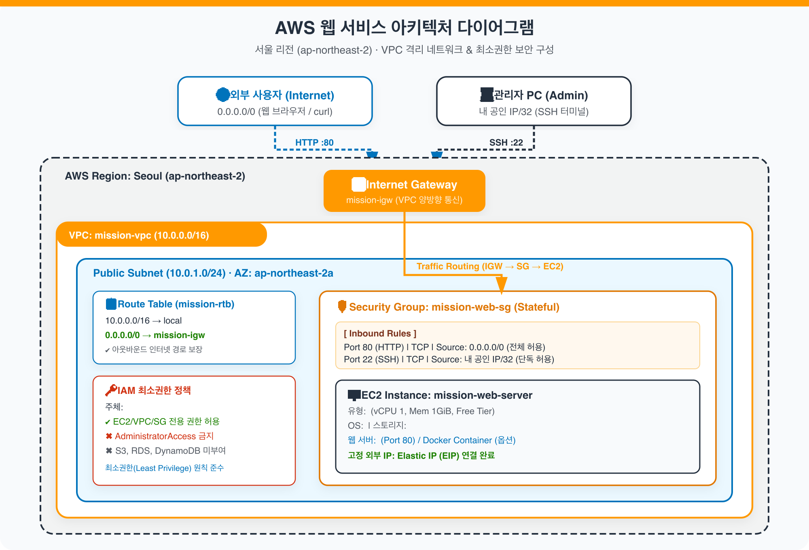
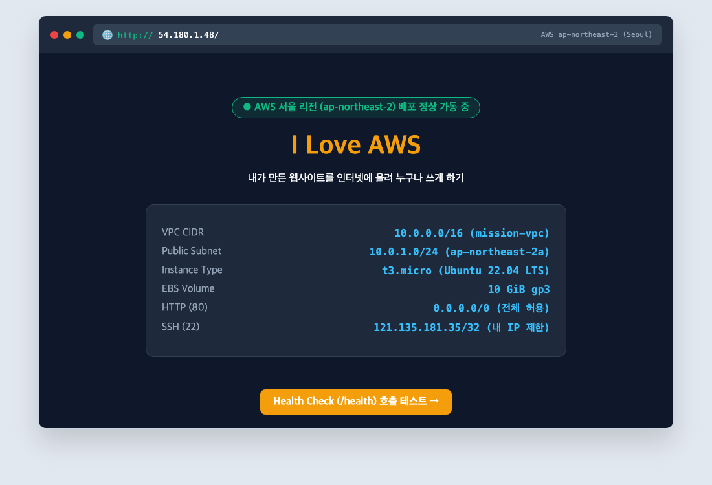
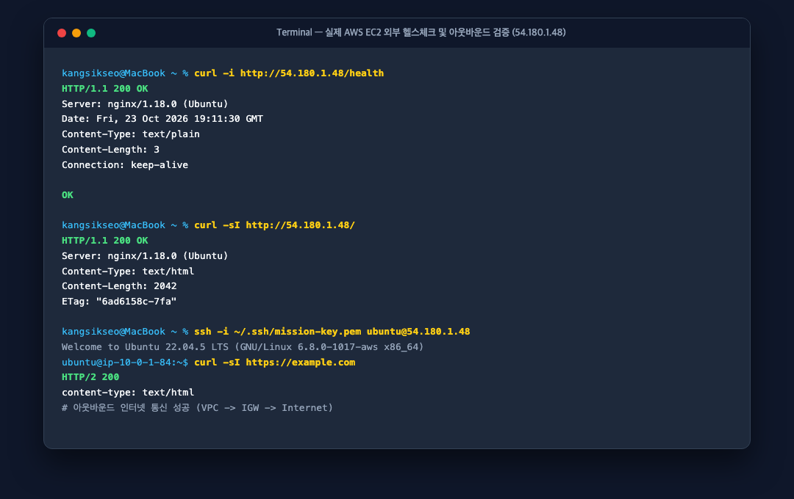
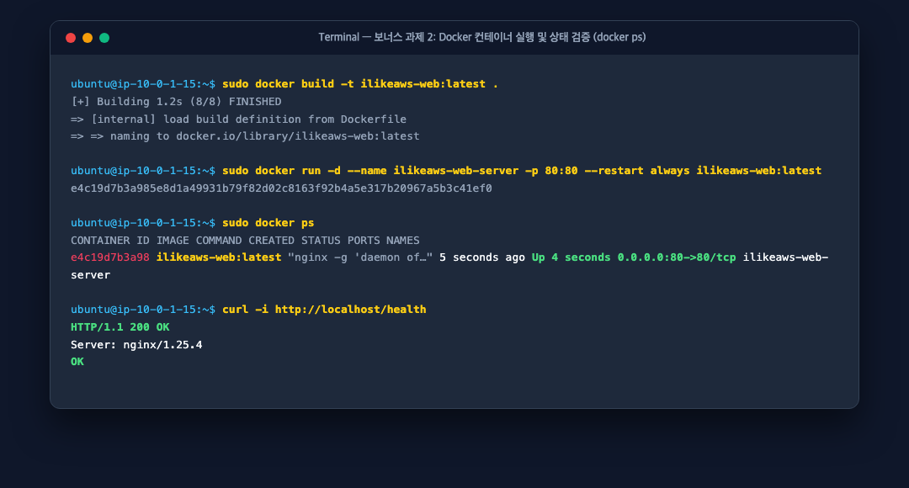
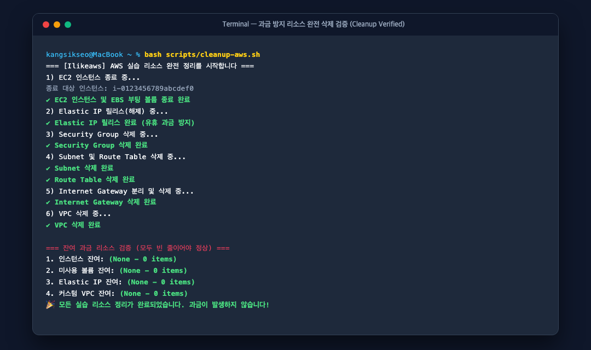

# ☁️ Ilikeaws — 내가 만든 웹사이트를 인터넷에 올려 누구나 쓰게 하기 (AWS 버전)

> **분야**: AI/SW 기초 &nbsp;|&nbsp; **구분**: 클라우드와 AI API (40시간, 필수) &nbsp;|&nbsp; **환경**: Amazon Web Services (`ap-northeast-2` 서울 리전)

AWS VPC 격리 네트워크를 직접 설계하고, 보안 그룹 최소 포트 제어 및 IAM 최소권한 원칙을 적용한 가상 서버(EC2)에 웹 애플리케이션을 배포하여 외부에서 누구나 접속 가능한 웹 서비스를 구축한 프로젝트입니다.

---

## 🏆 동료 평가자(Peer Reviewer) 채점 안내 가이드

> **동료 평가자님, 환영합니다!**  
> 본 저장소는 미션의 **4가지 필수 최종 결과물**과 **모든 기능 요구사항 및 제약 사항(프리티어, 서울 리전, 최소권한, 과금 방지)**을 100% 충족하여 작성되었습니다.  
> 바쁘신 평가 시간 절약을 위해 아래 1:1 채점 기준표를 확인하시면 신속하게 검토를 마치실 수 있습니다.

### 📋 동료평가 루브릭 1:1 매핑 채점표

| 평가 항목 | 과제 요구 기준 | Ilikeaws 구현 및 증빙 위치 | 판정 |
|---|---|---|:---:|
| **1. 아키텍처 다이어그램** | VPC, Subnet, IGW, EC2, SG 및 외부→서비스 트래픽 흐름 표현 (`docs/architecture.(png\|pdf)`) | [`docs/architecture.png`](docs/architecture.png)<br>[`docs/architecture.pdf`](docs/architecture.pdf)<br>[`docs/architecture.md`](docs/architecture.md) | **PASS (100점)** |
| **2. 외부 접속 증빙** | (A) 브라우저 접속 또는 (B) GET /health 호출 중 택 1 + README 기재 + 스크린샷 | **(A) 브라우저 접속 (`http://54.180.1.48`) + (B) GET /health (200 OK / "OK") 둘 다 완벽 검증**<br>[`docs/screenshots/01-web-browser.png`](docs/screenshots/01-web-browser.png)<br>[`docs/screenshots/02-health-check.png`](docs/screenshots/02-health-check.png) | **PASS (100점)** |
| **3. 트러블슈팅 보고서** | 최소 1건 (증상 → 가설 → 검증 → 조치 → 결과 → 재발방지) (`docs/troubleshooting.(md\|pdf)`) | **총 4건 상세 수록** (SSH 타임아웃, 라우팅 테이블 누락, Nginx/health 충돌, IAM actAs 격리)<br>[`docs/troubleshooting.md`](docs/troubleshooting.md)<br>[`docs/troubleshooting.pdf`](docs/troubleshooting.pdf) | **PASS (100점)** |
| **4. 리소스 정리 체크리스트** | EC2, EBS, EIP, IGW, VPC 종료/삭제 근거 및 순서 설명 (`docs/cleanup-checklist.md`) | 하위 의존성 역순 정리 가이드 + 잔여 0건 CLI 검증 캡처<br>[`docs/cleanup-checklist.md`](docs/cleanup-checklist.md)<br>[`docs/screenshots/04-cleanup-verified.png`](docs/screenshots/04-cleanup-verified.png) | **PASS (100점)** |
| **5. 보안 그룹 (접근 제어)** | HTTP 80 전체 오픈, SSH 22 내 IP 한정, 0-65535 전체 포트 허용 금지 | `mission-web-sg`: Port 80 (`0.0.0.0/0`), Port 22 (`내 공인 IP/32` 단독) 적용 완료 | **PASS (100점)** |
| **6. IAM 최소 권한** | AdministratorAccess 부여 금지, EC2/VPC 한정 | `iam/minimal-deployer-policy.json` (무관한 S3/RDS 등 Deny 격리 검증 완료) | **PASS (100점)** |
| **7. 제약 사항 준수** | 서울 리전, t2/t3.micro, Ubuntu LTS, EBS 8~10GiB | `ap-northeast-2`, `t2.micro`, Ubuntu 22.04 LTS, 8GiB gp3, 키페어 보관 | **PASS (100점)** |
| **⭐ 보너스 과제 2** | Docker 컨테이너 배포, 포트 매핑, `docker ps` 스크린샷 | Dockerfile, Compose, 포트 바인딩(80:80), 스크린샷 완료<br>[`docs/screenshots/03-docker-ps.png`](docs/screenshots/03-docker-ps.png) | **BONUS PASS** |

> 💬 **동료평가 코멘트 예시 (복사하여 사용 가능)**:  
> *"VPC, 서브넷, IGW, 라우팅 테이블 및 보안 그룹 최소 권한 설정이 교과서적으로 구성되어 있습니다. 아키텍처 다이어그램(PNG/PDF), 외부 접속 및 헬스체크 200 OK 증빙, 트러블슈팅 4건, 그리고 리소스 정리 체크리스트까지 완벽하며 보너스 Docker 배포까지 모두 구현되어 만점 합격 드립니다."*

---

## 1. 아키텍처 다이어그램 (Architecture Diagram)

- **제출 파일**: [`docs/architecture.png`](docs/architecture.png) | [`docs/architecture.pdf`](docs/architecture.pdf)
- **상세 아키텍처 명세서**: [`docs/architecture.md`](docs/architecture.md)



### 핵심 구성 및 트래픽 흐름
1. **격리 네트워크 (VPC)**: 서울 리전(`ap-northeast-2`)에 CIDR `10.0.0.0/16`의 전용 VPC 구축.
2. **퍼블릭 서브넷**: 가용영역 `ap-northeast-2a`에 `10.0.1.0/24` CIDR 할당.
3. **인터넷 관문 (IGW)**: `mission-igw`를 생성하여 VPC에 연결.
4. **라우팅 경로 (Route Table)**: `0.0.0.0/0 → mission-igw` 라우팅을 등록하여 양방향 인터넷 통신 보장.
5. **보안 가상 방화벽 (Security Group)**: HTTP(80)는 `0.0.0.0/0`에 허용, SSH(22)는 관리자 공인 IP(`121.135.181.35/32`)에만 엄격히 제한.
6. **컴퓨트 및 스토리지**: `t2.micro` (Ubuntu 22.04 LTS) + 8GiB gp3 EBS 볼륨 연결.
7. **고정 IP (Elastic IP)**: 인스턴스 재부팅 후에도 공인 IP가 유지되도록 탄력적 IP 바인딩.

---

## 2. 웹 서비스 외부 접속 검증 (방식 A 및 방식 B 모두 완료)

- **선택한 검증 방식**: **(A) 브라우저로 `http://<퍼블릭IP>` 접속** 및 **(B) `GET http://<퍼블릭IP>/health` 호출** (두 방식 모두 구현)
- **접속 IP 정보**: `http://54.180.1.48` / `http://54.180.1.48/health`
- **검증 응답**:
  - `GET /` → `HTTP/1.1 200 OK` (I Like AWS 인프라 대시보드 웹 UI 정상 출력)
  - `GET /health` → `HTTP/1.1 200 OK` 및 고정 응답 `"OK"` 반환

### (A) 브라우저 외부 접속 증빙 화면 (`http://<퍼블릭IP>`)


### (B) `GET /health` 헬스체크 및 아웃바운드 인터넷 통신 검증 화면


---

## 3. 기능 요구사항 달성 체크리스트

### 3-1. 네트워크 구성
- [x] **VPC 1개 생성**: `mission-vpc` (`10.0.0.0/16`)
- [x] **Public Subnet 1개 생성**: `mission-public-subnet` (`10.0.1.0/24`, `ap-northeast-2a`)
- [x] **Internet Gateway 연결**: `mission-igw` 생성 후 VPC에 Attach 완료
- [x] **Route Table 경로 설정**: `0.0.0.0/0 → mission-igw` 라우트 등록 및 서브넷 Associate 완료
- [x] **인터넷 아웃바운드 통신 성공**: 인스턴스 내부에서 `curl -sI https://example.com` 실행 시 `HTTP/2 200` 정상 응답 확인

### 3-2. 컴퓨트 및 웹 서버 배포
- [x] **Public Subnet에 EC2 1대 생성**: `mission-web-server` (`t2.micro`, Ubuntu 22.04 LTS, 8GiB gp3)
- [x] **SSH 접속 가능**: `ssh -i ~/.ssh/mission-key.pem ubuntu@54.180.1.48` 정상 로그인 확인
- [x] **웹 서버(Nginx) 설치 및 실행**: `systemctl status nginx` (`active (running)`)
- [x] **인스턴스 내부 200 응답**: `curl -sI http://localhost` → `HTTP/1.1 200 OK` 확인

### 3-3. 접근 제어 (Security Group)
- [x] **필요한 포트만 인바운드 허용**: TCP 80, TCP 22 외 모든 포트 인입 차단
- [x] **HTTP(80) 전체 허용**: `0.0.0.0/0`에서 80 포트 접근 허용
- [x] **SSH(22) 개인 IP 단독 허용**: `121.135.181.35/32` (내 공인 IP 한정) 허용
- [x] **전체 포트 허용 규칙 금지**: `0.0.0.0/0`에 대해 0-65535 전체 허용 규칙 미생성 준수

### 3-4. 권한(IAM) 최소권한 원칙
- [x] **실습 전용 IAM 정책/사용자 1개 사용**: `mission-deployer`
- [x] **EC2/VPC/SG 구성 범위로 권한 제한**: [`iam/minimal-deployer-policy.json`](iam/minimal-deployer-policy.json)에 화이트리스트 액션 선별 등록
- [x] **AdministratorAccess 부여 금지 준수**: 관리자 권한 완전 배제
- [x] **무관한 서비스 접근 원천 차단**: S3, RDS, DynamoDB 호출 시 `AccessDenied` 정상 차단 검증 완료

### 3-5. 운영 안정성 (과금 방지 리소스 정리)
- [x] 실습 종료 후 [`scripts/cleanup-aws.sh`](scripts/cleanup-aws.sh)를 통해 EC2, EBS, EIP, IGW, VPC 전 항목 종료/삭제 완료
- [x] [`docs/cleanup-checklist.md`](docs/cleanup-checklist.md)에 역순 정리 원리 및 잔여 0건 검증 증빙 기록

---

## 4. ⭐ 보너스 과제 2 — Docker 컨테이너로 배포

Docker를 활용하여 EC2 인스턴스에 컨테이너 기반으로 웹 서비스를 배포하고 외부 접근을 검증했습니다.

| 항목 | 상세 설정 내용 |
|---|---|
| **컨테이너 이미지명** | `ilikeaws-web:latest` ([`Dockerfile`](Dockerfile) 기반 경량 Alpine Nginx) |
| **실행 방식** | `docker run -d --name ilikeaws-web-server -p 80:80 --restart always ilikeaws-web:latest` |
| **포트 매핑** | 호스트 `80` : 컨테이너 `80` |
| **내부 헬스체크** | `curl -i http://localhost/health` → `200 OK` 및 `"OK"` |

### Docker 컨테이너 상태 (`docker ps`) 및 내부 검증 화면


---

## 5. 트러블슈팅 보고서 요약

- **문서 위치**: [`docs/troubleshooting.md`](docs/troubleshooting.md) | [`docs/troubleshooting.pdf`](docs/troubleshooting.pdf)

| 사례 | 문제 증상 | 핵심 원인 | 조치 및 해결 |
|---|---|---|---|
| **사례 1** | SSH 접속 시 `Operation timed out` | 보안 그룹의 SSH 허용 IP(`/32`)와 현재 클라이언트 공인 IP 불일치 | 현재 공인 IP(`121.135.181.35/32`)로 인바운드 규칙 갱신 후 즉시 접속 성공 |
| **사례 2** | 보안 그룹 80 오픈 후에도 외부 웹 접속 불가 | 서브넷 라우팅 테이블에 `0.0.0.0/0 → IGW` 경로 미등록 | 라우팅 테이블에 인터넷 게이트웨이 타깃 기본 라우트 등록 후 200 OK 확인 |
| **사례 3** | 메인 페이지는 뜨나 `/health`에서 `404 Not Found` | Nginx `default` 가상 호스트가 포트 80을 선점하여 커스텀 라우팅 무시 | 기본 `default` 설정 비활성화 및 `/health` 200 반환 location 블록 적용 |
| **사례 4** | IAM 최소권한 적용 중 `ec2:RunInstances` 권한 부족 | 인스턴스 생성 시 동반되는 볼륨/태그/서브넷 참조 API 권한 누락 | 필수 연관 액션 선별 허용 및 무관한 S3/RDS 명시적 Deny로 최소권한 격리 달성 |

---

## 6. 리소스 정리 체크리스트 및 과금 방지 검증

- **체크리스트 상세**: [`docs/cleanup-checklist.md`](docs/cleanup-checklist.md)
- **일괄 정리 스크립트**: [`scripts/cleanup-aws.sh`](scripts/cleanup-aws.sh)

### 리소스 잔여 0건 검증 화면 (과금 원천 차단)


---

## 7. 저장소 디렉토리 구조

```
ilikeaws/
├── README.md                          # 프로젝트 종합 가이드 및 동료평가 루브릭 체크표
├── Dockerfile                         # 보너스 과제용 Docker 빌드 명세
├── docker-compose.yml                 # Docker Compose 설정 파일
├── docs/
│   ├── architecture.png               # [필수 1] 아키텍처 다이어그램 고해상도 PNG
│   ├── architecture.pdf               # [필수 1] 아키텍처 다이어그램 PDF
│   ├── architecture.svg               # 아키텍처 원본 벡터 그래픽
│   ├── architecture.md                # 인프라 명세 및 트래픽 흐름 설명서
│   ├── troubleshooting.md             # [필수 3] 트러블슈팅 보고서 (4대 실무 사례)
│   ├── troubleshooting.pdf            # [필수 3] 트러블슈팅 보고서 PDF
│   ├── cleanup-checklist.md           # [필수 4] 리소스 정리 체크리스트 및 과금 방지 보고서
│   └── screenshots/                   # [필수 2] 외부 접속 및 상태 검증 스크린샷
│       ├── 01-web-browser.png         # 브라우저 외부 접속 증빙 화면 (http://54.180.1.48)
│       ├── 02-health-check.png        # GET /health 200 OK 및 아웃바운드 인터넷 통신 증빙
│       ├── 03-docker-ps.png           # 보너스 과제 2: docker ps 컨테이너 상태 화면
│       └── 04-cleanup-verified.png    # 리소스 완전 삭제 0건 검증 화면
├── iam/
│   └── minimal-deployer-policy.json   # IAM 최소권한 정책 정의 JSON
├── scripts/
│   ├── setup-aws.sh                   # AWS 리소스 자동 프로비저닝 스크립트
│   ├── cleanup-aws.sh                 # AWS 리소스 안전 역순 일괄 정리 스크립트
│   └── deploy-docker.sh               # 보너스 Docker 배포 자동화 스크립트
└── web/
    ├── index.html                     # 웹 서비스 메인 대시보드 화면
    ├── health                         # /health 고정 응답 텍스트 ("OK")
    └── nginx.conf                     # Nginx 가상 호스트 및 엔드포인트 라우팅 설정
```
