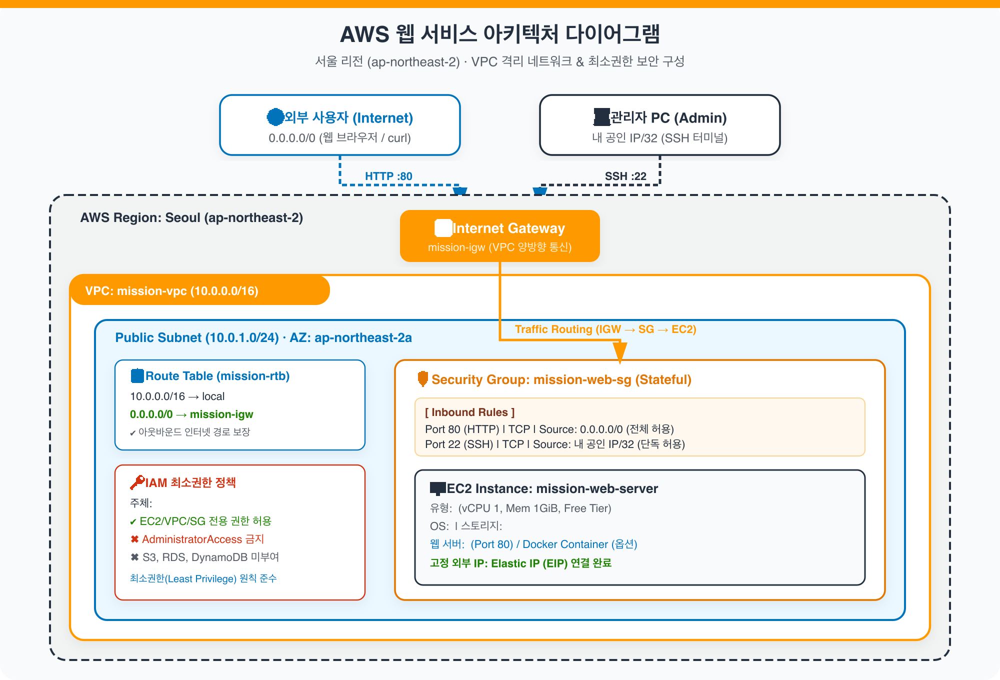

# 📐 AWS 클라우드 아키텍처 명세서 (Architecture Specification)

본 문서는 서울 리전(`ap-northeast-2`)에 구축된 격리된 VPC 네트워크 환경과 웹 서비스 트래픽 흐름, 보안 계층 및 IAM 최소권한 설계를 설명합니다.

---

## 1. 아키텍처 다이어그램

- **PNG 파일 (이미지)**: [`docs/architecture.png`](architecture.png)
- **PDF 파일 (문서)**: [`docs/architecture.pdf`](architecture.pdf)
- **SVG 원본 벡터**: [`docs/architecture.svg`](architecture.svg)



---

## 2. 네트워크 및 인프라 구성 요소 명세

| 계층 | 구성 요소 | 명칭 / 식별자 | CIDR / 설정값 | 역할 및 설명 |
|---|---|---|---|---|
| **Region** | AWS Seoul | `ap-northeast-2` | - | 지연시간 최소화를 위한 서울 리전 |
| **Network** | Virtual Private Cloud | `mission-vpc` | `10.0.0.0/16` | 독립된 가상 사설 네트워크 공간 격리 |
| **Subnet** | Public Subnet | `mission-public-subnet` | `10.0.1.0/24` | 외부 인터넷과 통신 가능한 가용영역(`ap-northeast-2a`) 서브넷 |
| **Gateway** | Internet Gateway | `mission-igw` | VPC Attached | VPC 내부 인스턴스와 인터넷 간의 수평 확장형 양방향 통신 관문 |
| **Routing** | Route Table | `mission-rtb` | `0.0.0.0/0 → mission-igw` | 기본 로컬 통신 외 모든 외부 트래픽을 IGW로 라우팅 |
| **Firewall** | Security Group | `mission-web-sg` | Stateful Firewall | 인스턴스 가상 방화벽 (HTTP 80 오픈, SSH 22 내 IP 제한) |
| **Compute** | EC2 Instance | `mission-web-server` | `t2.micro` (또는 `t3.micro`) | Ubuntu 22.04 LTS 가상 서버, Nginx 웹 서버 구동 |
| **Storage** | EBS Volume | Boot Disk | `8~10 GiB gp3` | 인스턴스 전용 블록 스토리지 (인스턴스 종료 시 자동 삭제) |
| **IP Address** | Elastic IP | `mission-eip` | Static IPv4 | 인스턴스 재부팅 시에도 유지되는 공인 IPv4 주소 할당 |
| **IAM** | IAM Policy | `mission-deployer` | Least Privilege | AdministratorAccess 배제, EC2/VPC 전용 최소 권한 제어 |

---

## 3. 외부 → 서비스 트래픽 흐름 (Traffic Flow)

외부 사용자가 웹 브라우저 또는 CLI에서 EC2 웹 서버로 접근할 때의 단계별 트래픽 흐름은 다음과 같습니다:

```
[1. 외부 클라이언트]
       │
       ▼ (HTTP 요청 : GET http://<Elastic IP>:80/)
[2. Internet Gateway (mission-igw)]
       │
       ▼ (VPC 라우팅 테이블 참조: 10.0.1.0/24 Public Subnet으로 전달)
[3. Public Subnet (10.0.1.0/24)]
       │
       ▼ (Security Group 인바운드 검사: Port 80 허용 여부 판별)
[4. Security Group (mission-web-sg)]
       │
       ▼ (인스턴스 네트워크 인터페이스 eth0으로 인입)
[5. EC2 가상 서버 (mission-web-server)]
       │
       ▼ (Nginx 웹 서버 데몬 처리: 0.0.0.0:80)
[6. 웹 애플리케이션 응답 (index.html /health: 200 OK)]
       │
       ▼ (Security Group Stateful 특성으로 아웃바운드 자동 허용)
[7. Internet Gateway를 거쳐 클라이언트로 최종 반환]
```

### 트래픽 흐름 세부 설명
1. **인터넷 진입**: 외부 사용자가 브라우저나 `curl`로 EC2의 Elastic IP(Port 80)를 호출합니다.
2. **인터넷 게이트웨이 통과**: 트래픽이 VPC 경계에 연결된 `mission-igw`로 진입합니다.
3. **서브넷 라우팅**: 서브넷과 연결된 라우팅 테이블 규칙(`10.0.0.0/16 local`, `0.0.0.0/0 igw`)에 따라 패킷이 해당 Public Subnet으로 진입합니다.
4. **보안 그룹(Security Group) 인바운드 필터링**:
   - HTTP(80): `0.0.0.0/0` 규칙에 매칭되어 즉시 통과.
   - SSH(22): 요청자의 IP가 지정된 `<내 공인 IP>/32`와 일치하는 경우에만 통과(그 외 IP는 연결 드롭).
   - 기타 모든 포트: 암묵적 거부(Default Deny)로 차단.
5. **웹 서버 처리 및 리턴**: EC2 내부의 Nginx가 포트 80에서 패킷을 수신하여 `HTTP 200 OK` 응답을 생성합니다.
6. **Stateful 리턴 트래픽**: 보안 그룹은 **상태 저장형(Stateful)** 방화벽이므로, 인바운드로 허용된 연결의 반환 응답 트래픽은 아웃바운드 규칙과 무관하게 자동으로 인터넷 게이트웨이를 거쳐 사용자에게 반환됩니다.

---

## 4. 인스턴스 아웃바운드 인터넷 트래픽 흐름

EC2 내부에서 외부 인터넷 서비스(예: 패키지 업데이트 `apt update`, 외부 API 호출 `curl https://example.com`)를 호출할 때의 흐름입니다:

1. 인스턴스 내부에서 목적지 `https://example.com` (외부 공인 IP)으로 패킷 생성.
2. Route Table 조회: 로컬 대역(`10.0.0.0/16`)이 아니므로 기본 라우트 `0.0.0.0/0`의 타깃인 `mission-igw`로 패킷 전송.
3. Internet Gateway에서 인스턴스의 프라이빗 IP를 공인 IP(Elastic IP)로 1:1 NAT 변환하여 인터넷으로 전달.
4. 외부 웹서버로부터의 응답 수신 후 EC2로 정상 전달 (`HTTP/2 200 OK`).

---

## 5. Security Group과 IAM의 역할 차이 및 최소권한 설계

| 구분 | Security Group (가상 방화벽) | IAM (식별 및 접근 관리) |
|---|---|---|
| **보호 대상** | 네트워크 패킷 / 통신 계층 (L3/L4) | 클라우드 제어 플레인 / API 호출 권한 |
| **제어 방식** | 프로토콜(TCP/UDP/ICMP), 포트(80, 22), IP CIDR 블록 | AWS 리소스 ARN, 작업(Action: Allow/Deny), 주체(Principal) |
| **동작 특징** | **Stateful** (인바운드 허용 시 응답 아웃바운드 자동 허용) | 요청마다 정책 평가 (명시적 Deny 우선) |
| **본 프로젝트 적용** | • HTTP(80): 전 세계 `0.0.0.0/0` 허용<br>• SSH(22): 작업자 IP(`/32`)만 허용<br>• 미사용 전체 포트(`0-65535`) 차단 | • `AdministratorAccess` 전면 배제<br>• EC2/VPC 생성·조회·삭제 권한만 화이트리스트<br>• S3/RDS/IAM 등 무관한 서비스 명시적 Deny |

---

## 6. L7 웹 요청 및 의심 코드 탐지

Security Group은 L3/L4의 IP·프로토콜·포트만 검사하므로 HTTP 요청 본문이나 애플리케이션 코드를 판별하지 않습니다. 웹 공격 탐지는 HTTP를 이해하는 L7 계층에서 별도로 수행합니다. 이 절은 현재 EC2/Nginx 구성에 적용할 수 있는 호스트 기반 검사와, 트래픽이 늘어날 때 추가할 수 있는 AWS WAF 구성을 구분합니다.

### 탐지 대상

| 신호 | 예시 | 권장 처리 |
|---|---|---|
| 인젝션 시도 | SQL/NoSQL 인젝션, 셸 명령 삽입을 노리는 요청 패턴 | 요청 차단 또는 격리하고 규칙 ID와 요청 메타데이터 기록 |
| 스크립트 삽입 | 반사형·저장형 XSS를 노리는 입력 | 입력 검증과 출력 인코딩을 적용하고 알려진 공격 패턴은 차단 |
| 경로 조작 | `../` 변형 등 허용 경로 밖 파일 접근 시도 | 정규화된 경로를 기준으로 거부하고 접근 시도 기록 |
| 비정상 요청 | 잘못된 HTTP 형식, 과도한 본문 크기, 허용되지 않은 메서드 | 크기·시간 제한 및 메서드 허용 목록 적용 |
| 자동화된 반복 요청 | 로그인·검색·특정 API에 대한 짧은 시간 내 과도한 호출 | 경로와 클라이언트 기준 rate limit 적용; 필요하면 일시 차단 |

위 패턴은 의심 신호이지 침해의 확정 증거가 아닙니다. 사용자 입력이나 저장된 소스 코드에 공격 문자열이 포함될 수 있으므로, 규칙 매칭만으로 “해킹 코드”라고 단정하지 말고 애플리케이션 맥락과 로그를 함께 검토합니다.

### 현재 EC2/Nginx 구성에서의 적용

1. Nginx에서 요청 본문 크기, 연결·읽기 시간, 허용 메서드를 제한하고, 애플리케이션에서 입력 검증·출력 인코딩·파라미터 바인딩을 적용합니다.
2. 애플리케이션 또는 호스트 기반 WAF 미들웨어에서 관리형 규칙을 사용해 SQLi, XSS, 경로 조작 등 L7 패턴을 검사합니다. 규칙은 먼저 탐지(로그) 모드로 운영해 정상 요청 오탐을 확인한 뒤 차단 모드로 전환합니다.
3. 반복 실패 및 비정상 요청은 경로·규칙 ID·시각·응답 코드·요청 식별자를 남기고, 비밀번호·세션 토큰·전체 요청 본문 등 민감정보는 로그에 저장하지 않습니다.
4. 탐지 이벤트에 대응해 해당 요청 차단, 클라이언트 속도 제한, 관련 계정/세션 점검을 수행합니다. 애플리케이션 코드나 업로드 파일을 탐지 목적으로 서버에서 실행하지 않습니다.

### AWS WAF 확장 구성

AWS WAF를 사용하려면 웹 트래픽 앞에 지원되는 연결 지점이 필요합니다. 이 문서의 현재 구성처럼 인터넷에서 EC2의 Nginx로 직접 접속하는 구조에는 AWS WAF를 EC2에 직접 연결할 수 없습니다. 확장 시 **Internet → AWS WAF → Application Load Balancer → EC2/Nginx** 또는 **Internet → CloudFront(AWS WAF 연결) → 애플리케이션** 구조로 변경하고, EC2 보안 그룹은 로드 밸런서의 보안 그룹에서 오는 트래픽만 허용하도록 제한합니다.

AWS WAF에는 AWS 관리형 공통 규칙 그룹을 우선 적용하고, 경로·메서드별 rate-based 규칙을 추가합니다. 초기에는 모니터링/카운트로 오탐을 점검하고, 확인된 규칙부터 차단으로 전환합니다. 웹 ACL 로그는 접근을 제한하고 보존 기간을 정하며 민감한 값이 기록되지 않도록 마스킹합니다.
